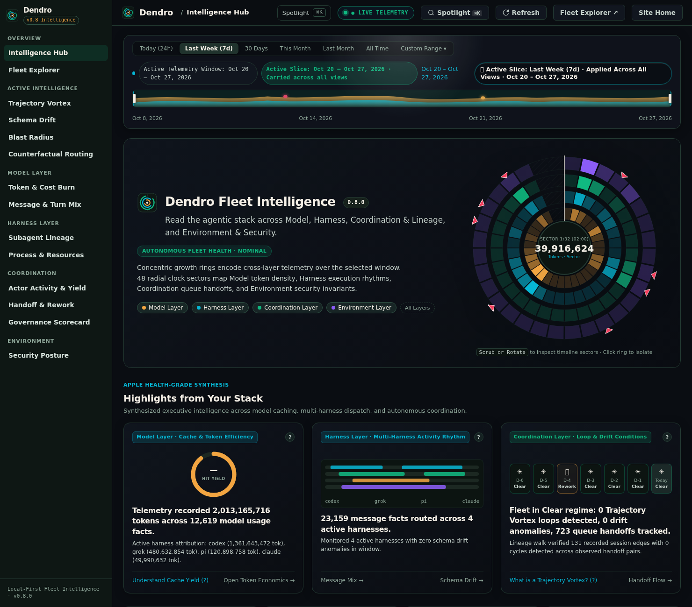
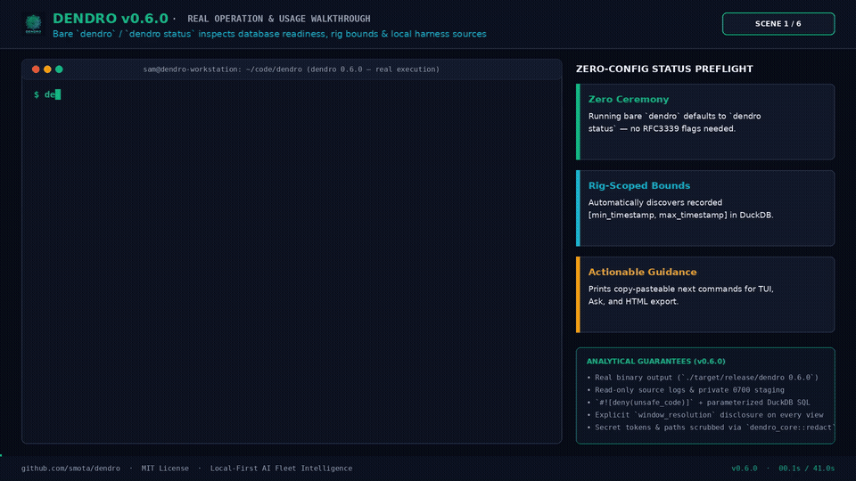
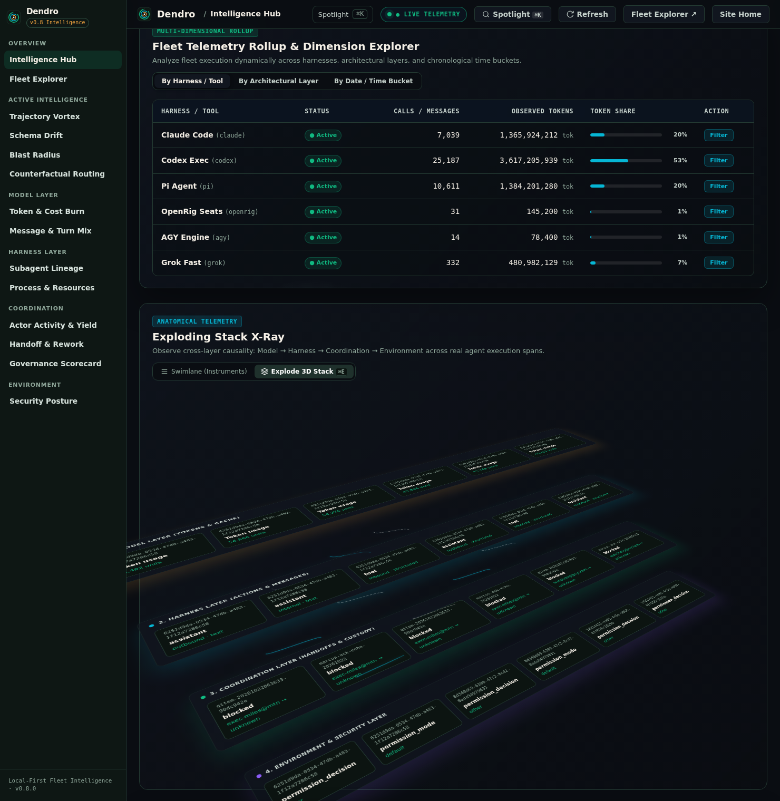
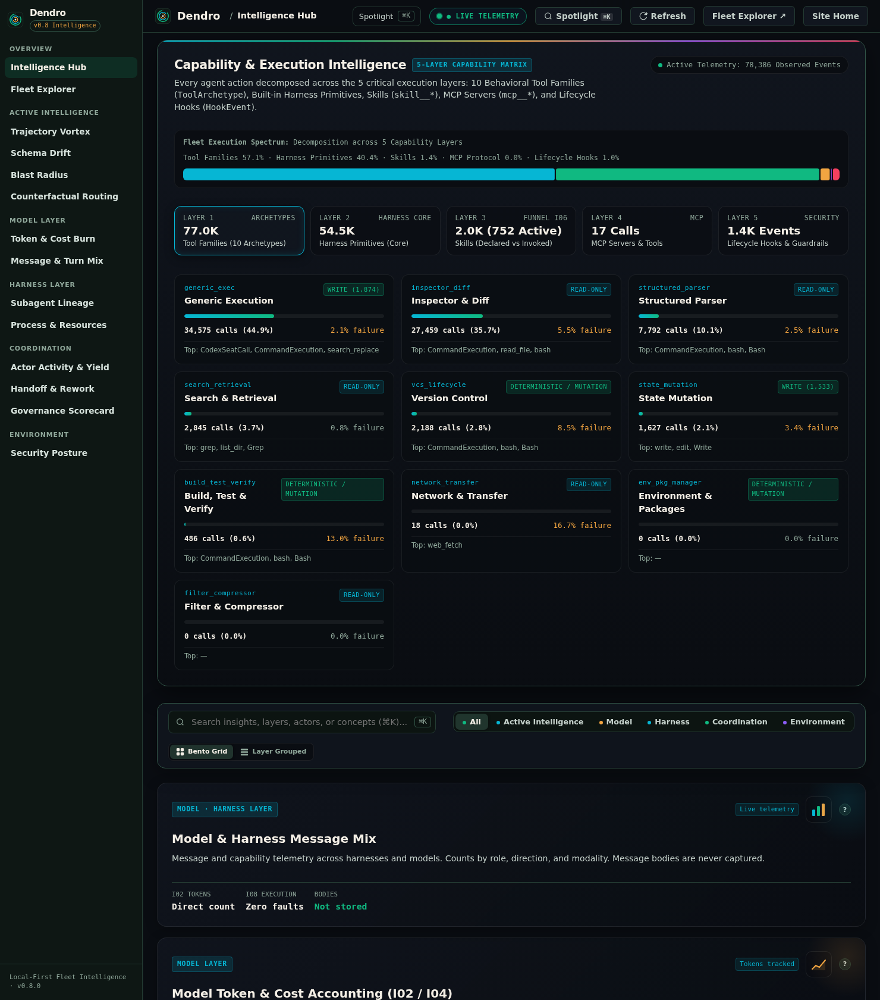
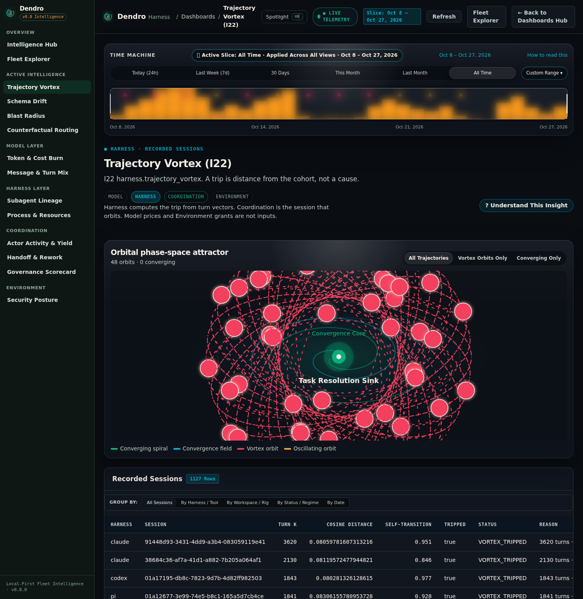
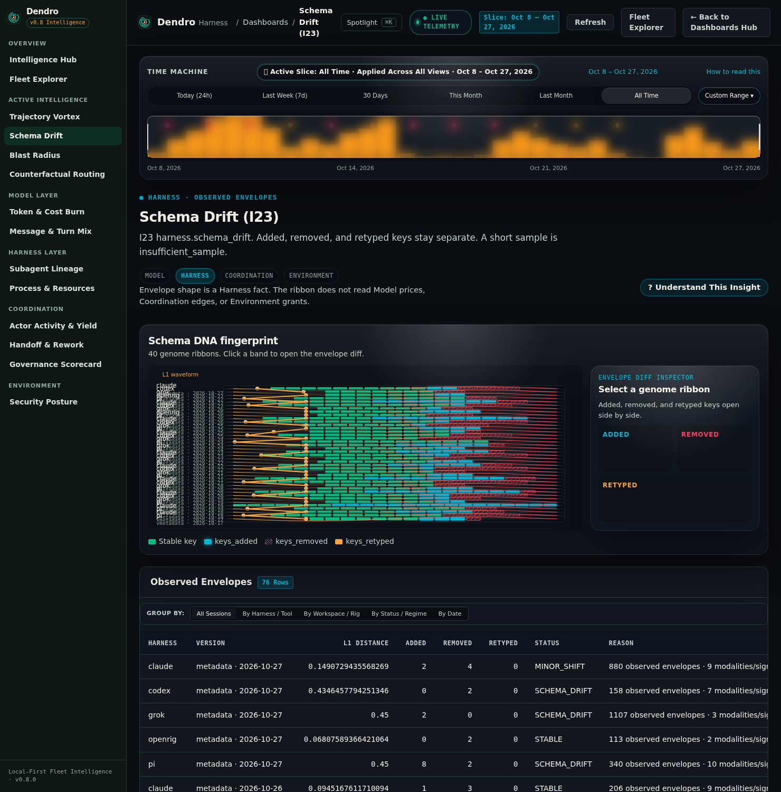
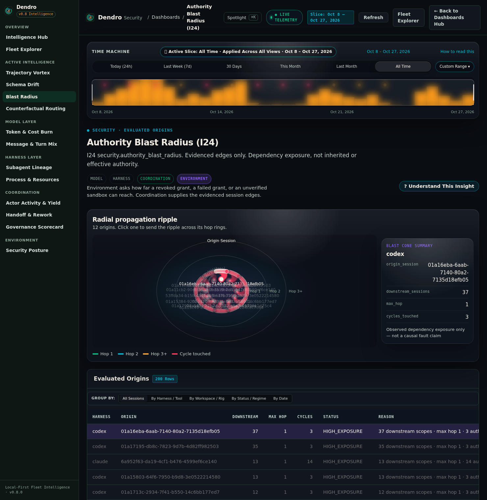
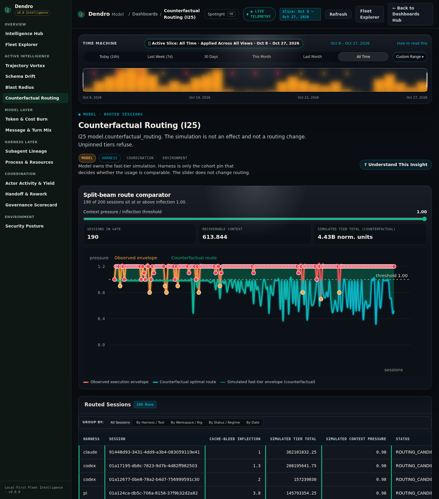
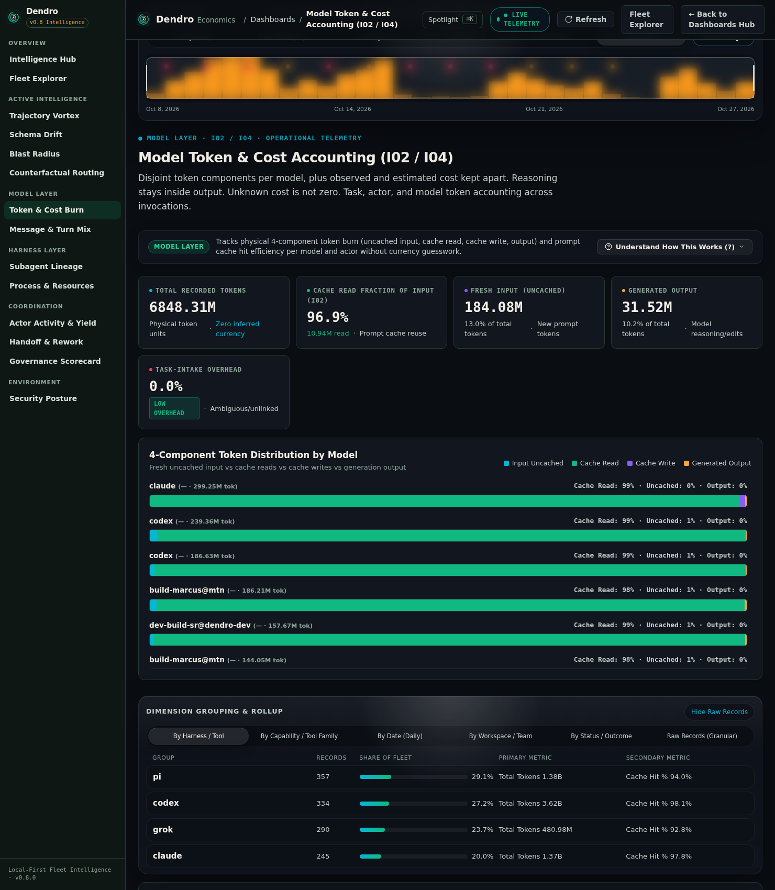

<div align="center">
  
  <h1>Dendro</h1>
  <p><strong>Decipher the growth layers of your AI agent fleets.</strong></p>
  <p>The Local-First Flight Recorder, Causal X-Ray &amp; Operational Intelligence Studio for Multi-Agent Engineering.</p>
  <p>
    <a href="#visual-tour">Visual Tour</a> ·
    <a href="#why-dendro">Why Dendro</a> ·
    <a href="#architecture">4-Layer + 5-Capability Architecture</a> ·
    <a href="#active-intelligence">Active Intelligence (I22–I25)</a> ·
    <a href="#quickstart">60-Second Quickstart</a> ·
    <a href="docs/README.md">Documentation Hub (Index)</a> ·
    <a href="#documentation">Documentation</a>
  </p>
</div>

**Your fleet has a history. Now you can read it.** Dendro reads the local session history your AI tools already write on your machine—turning scattered agent runs into a unified flight recorder and operational intelligence studio. See where your budget goes, which tools and skills actually deliver, and where multi-agent handoffs slow down.

Built on an **open, extensible architecture**, Dendro supports AI coding clients **Claude Code, OpenAI Codex, Google Antigravity, Grok, and Pi**, plus verified export adapters for **Cursor, Windsurf, Goose, and Devin**. Fleet orchestration runtimes such as **OpenRig, AgentFlow, and Meshloop** coordinate teams and handoffs across those clients. Dendro includes OpenRig integration out of the box. Bring your own client, orchestrator, or capability mapper through the [extension guide](docs/extensions/README.md). You keep control of your fleet; Dendro helps you understand it.

<div align="center">
  
  <p><strong>Read your entire fleet like an instrument.</strong> Scrub across any time window with the <strong>Time Machine</strong>, spot anomalies at a glance on <strong>The Living Growth Rings</strong>, and jump straight from <strong>Story Highlights</strong> into the underlying layer.</p>
</div>

<a id="why-dendro"></a>

## Why Dendro?

When you work with multiple AI coding agents, sub-agents, skills, and MCP servers, you see the final diff or the monthly bill. You rarely see *why* a task took 40 minutes, *which* sub-agent looped, or *whether* your custom skill was ever invoked.

- **Stop paying for invisible waste.** You can spot retry loops, uncached context refills, and runaway sub-agents before they drain your token budget.
- **Know which tools, skills, and MCP servers actually deliver.** You can see which capabilities your agents rely on to finish work, which fail silently, and which sit unused.
- **Pinpoint where multi-agent workflows stall.** You can trace a slowdown to time inside the model, a failing tool call, a sub-agent handoff, or a human approval gate wherever supporting evidence is available.
- **Test routing changes before you touch production.** You can simulate how fast-tier models or context limits would affect your real workload before changing a single configuration.

<a id="architecture"></a>

### One studio across every layer of your stack

Your **4 Architectural Layers** connect budget, execution, handoffs, and the machine underneath them:

| Layer | What You See | What You Can Decide & Improve |
| --- | --- | --- |
| **Model** | Your token spend, cache yield, and routing scenarios | You can target budget hotspots and compare model or context policies. |
| **Harness** | Your tool retries, execution loops, and changes after client upgrades | You can find failing tools and decide which client or configuration needs attention. |
| **Coordination** | Your sub-agent lineage, handoff waits, returns, and approval gates | You can remove bottlenecks and clarify who should pick up work next. |
| **Environment** | Your sessions' CPU and memory footprint, sandbox posture, and dependency exposure | You can review resource pressure and permission boundaries. |

Your **5 Capability Layers** reveal what your agents actually use within that stack:

| Layer | What You See | What You Can Decide & Improve |
| --- | --- | --- |
| **Tool Families** | Your execution mix across Shell / Exec, Read / Inspect, Edit / Patch, Search / Grep, Subagent Spawn, MCP Call, Skill Load, Web / Fetch, Task / Queue, and Governance / Gate | You can see where effort concentrates and investigate repeated work. |
| **Harness Primitives** | Your clients' native tools, observed outcomes, and failure patterns | You can repair unreliable tool paths and compare behavior across clients. |
| **Skills (Declared vs. Invoked)** | Your available skills alongside evidence of actual invocation | You can improve skill discovery and revisit unused instructions. |
| **MCP Servers & Tools** | Your observed calls grouped by server and tool | You can identify dependable integrations and investigate silent failures. |
| **Lifecycle Hooks & Guardrails** | Your recorded hook stages, interceptions, and gate observations | You can tune checks and review where approvals delay work. |

**Your history stays yours.** Source logs are read-only. No prompts, agent thoughts, code completions, or secrets (`sk-`, `ghp_`, Bearer tokens) are ever captured or stored. Everything runs locally on your machine—nothing is proxied or sent to a third-party cloud.

You can follow each finding to its observation window and supporting evidence, with gaps kept visible. Compare recorded costs with your own pricing scenarios, while keeping token consumption separate from judgments about productivity.

<a id="visual-tour"></a>

## Visual Tour

<div align="center">
  <a href="docs/assets/dendro-demo.mp4">
    
  </a>
  <p>
    <a href="docs/assets/dendro-demo.mp4"><strong>▶ Watch the Connected Intelligence Studio in motion</strong></a>
    &nbsp;·&nbsp;
    <a href="docs/VIDEO_WALKTHROUGH.md">Follow the walkthrough</a>
  </p>
</div>

Follow a fleet-wide signal into the stack, inspect the capabilities behind it, and choose your next move.

### 4-Layer Stack X-Ray



**Pull the stack apart (`⌘E`).** Trace execution across **Model → Harness → Coordination → Environment** in flat swimlanes or 3D isometric view, and pivot instantly by harness, layer, or date.

### 5-Layer Capability & Execution Intelligence



**Know what your agents actually use.** See the balance across **Tool Families, Harness Primitives, Skills (Declared vs. Invoked), MCP Servers & Tools, and Lifecycle Hooks & Guardrails**—so you know which capabilities drive results and which sit dormant.

<a id="active-intelligence"></a>

### Active Intelligence (`I22`–`I25`)

<table>
  <tr>
    <td width="50%" valign="top">
      
      <p><strong>I22 · Trajectory Vortex: Catch loops before runaway token burn.</strong></p>
      <p>Inspect repetitive behavior and stalled reasoning orbits to choose the next session to investigate.</p>
    </td>
    <td width="50%" valign="top">
      
      <p><strong>I23 · Schema Drift: Spot structural shifts after an upgrade.</strong></p>
      <p>Compare telemetry shapes across Claude Code, OpenAI Codex, Google Antigravity, Grok, and Pi to identify the connector or version that needs attention.</p>
    </td>
  </tr>
  <tr>
    <td width="50%" valign="top">
      
      <p><strong>I24 · Authority Blast Radius: Map your dependency exposure.</strong></p>
      <p>Follow downstream session reachability from a permission grant or failure to focus your review.</p>
    </td>
    <td width="50%" valign="top">
      
      <p><strong>I25 · Counterfactual Model Routing: Test routing choices against history.</strong></p>
      <p>Explore fast-tier thresholds and context-pressure inflections against recorded sessions without touching live production traffic.</p>
    </td>
  </tr>
</table>

### Operational Economics



**Every token accounted for, sliced your way.** Separate cache reads, cache writes, fresh input, and reasoning output, then group by **Harness, Capability, Date, Workspace, or Outcome** in one click.

[Explore the Visual Product Tour →](docs/VISUAL_PRODUCT_TOUR.md)

## Who is Dendro for?

| Operator | Daily playbook |
| --- | --- |
| **Applied-AI Engineers** | Scrub a difficult run, inspect tools and trajectory loops, then trace the evidence behind retries. |
| **Fleet Architects** | Follow sub-agent lineage and handoff friction; compare topology scenarios against recorded work. |
| **FinOps / Token Economists** | Split cache and uncached consumption, group by harness or team, and compare pinned pricing scenarios. |
| **Security & Governance Leads** | Inspect sandbox and hook observations, review evidenced downstream exposure, and retain operator authority over changes. |

## Extensible by Design — Bring Your Own Stack

Keep the tools and workflows you already trust. Start with the built-in connectors, then bring your own client, orchestration runtime, or capability mapper through the same open extension contracts.

| Stack component | Supported out of the box today | Your path to more |
| --- | --- | --- |
| **Coding Clients** | Claude Code, OpenAI Codex, Google Antigravity, Grok, and Pi | Add a connector for the local session history your client writes. |
| **Editor/Agent Export Adapters** | Verified Cursor, Windsurf, Goose, and Devin export formats | Select a supported export format; coverage depends on what that format records. |
| **Fleet Orchestration Runtimes** | OpenRig: rigs, seats, queues, and handoffs | Connect other runtimes, such as AgentFlow or Meshloop, through their available coordination records. |

OpenRig brings team structure and handoff history into your studio. Use the runtime extension contract to add another orchestrator, and check each export adapter's documented formats and coverage before importing your history.

- [Bring Your Own Client or Runtime](docs/extensions/README.md) — Connect local execution records and extend capability mappings.
- [Supported Export Formats](docs/extensions/formats.md) — Check verified schemas, available metrics, and coverage limits.
- [Contributing Guide](CONTRIBUTING.md) — Help bring the next component to Dendro.

<a id="quickstart"></a>

## Start locally (60-Second Quickstart)

Install with Cargo (puts `dendro` on your `PATH`):

```sh
cargo install --git https://github.com/smota/dendro.git dendro-cli --locked
dendro run
dendro dashboard --serve 127.0.0.1:4242
```

Or build and run directly from a Git checkout (current):

```sh
git clone https://github.com/smota/dendro.git
cd dendro
cargo build --release --locked
./target/release/dendro run
./target/release/dendro dashboard --serve 127.0.0.1:4242 --site-dir ./site
```

Open **http://127.0.0.1:4242** in your browser. The studio stays local; press `Ctrl-C` to stop the server. Building from source takes additional time depending on your machine.

Prefer the terminal? In a separate terminal, choose an entry point:

```sh
./target/release/dendro status                 # Check your local sources and fleet brief
./target/release/dendro dashboard --auto-ingest # Open the interactive terminal cockpit
./target/release/dendro ask "where do tokens go?"
```

Press `?` in the cockpit for shortcuts. For custom source roots, fixed time windows, exports, and advanced flags, see the [Operator Guide](docs/adoption/README.md) and [CLI Reference](docs/CLI_R1.md).

## Verification

```sh
cargo check --workspace --locked
cargo test --workspace --locked
cargo clippy --workspace --locked -- -D warnings
cargo fmt --check
node --test site/site.test.cjs
```

The real-local-log performance test is explicitly ignored by default and requires a separately authorized corpus. Synthetic correctness or benchmark results do not establish production-scale latency. See the benchmark's actual output and corpus before quoting a performance claim; milliseconds must not be called sub-millisecond.

## Documentation

- [Documentation Hub (Index)](docs/README.md): choose your path through Dendro.
- [Visual Product Tour](docs/VISUAL_PRODUCT_TOUR.md): the connected studio and focused consoles.
- [Architecture Blueprint](docs/ARCHITECTURE.md): four architectural layers, five capability layers, Schema 5, and insight contracts.
- [Operator guide](docs/adoption/README.md): status, cockpit, source selection, reporting, privacy and reproducible replay.
- [CLI reference](docs/CLI_R1.md) and [Nao & local semantic queries](docs/NAO_SEMANTIC.md).
- [Studio walkthrough](docs/VIDEO_WALKTHROUGH.md): follow the connected studio in motion.
- [Maintainer guide](docs/maintainers/README.md): workspace architecture and quality gates.
- [Bring Your Own Client or Runtime](docs/extensions/README.md) and [Supported Export Formats](docs/extensions/formats.md): extension contracts, examples, and verified coverage.
- [Contributing Guide](CONTRIBUTING.md): help extend Dendro.
- [Product specification](docs/PRODUCT_SPECIFICATION.md) and [R1 acceptance contracts](docs/ACCEPTANCE_R1.md).
- [Real operation walkthrough video](docs/assets/dendro-demo.mp4) and [preview animation](docs/assets/dendro-preview.gif).

## Privacy and license

Source logs are read-only. No prompts, agent thoughts, code completions, or secrets (`sk-`, `ghp_`, Bearer tokens) are ever captured or stored. Everything runs locally on your machine—nothing is proxied or sent to a third-party cloud. You choose whether to export or share a report.

MIT License. Copyright 2026 Samuel Mota.
