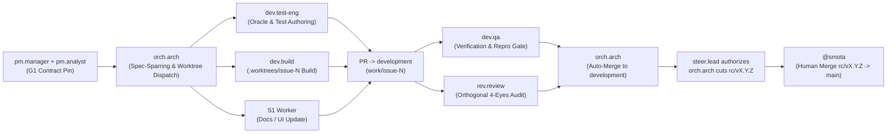

# Dendro Cross-Squad Handoff & Sibling Protocol (`sibling.md`)

This document defines the live OpenRig cross-squad topology, canonical seat addresses, operator multi-front interaction model, and parallel worktree handoff sequence for **Dendro** (`smota/dendro`).

> **Rule of Address:** Always address peers by their canonical OpenRig session name below. Never invent a session name or route work to another project's squad.

---

## 1. Canonical Seats Across the 3 Pods

Dendro operates under the `subscription-balanced-v1` execution distribution across three specialized pods: a supervisory plane (`dendro-steer`), a framing & community squad (`dendro-pm`), and an architecture, parallel build & assurance squad (`dendro-dev`).

| Pod | Seat ID | Canonical OpenRig Address | Mode | Primary Model (`effort`) | Fallback Models (`effort`) | Path Ownership / Guard |
| :--- | :--- | :--- | :--- | :--- | :--- | :--- |
| **`dendro-steer`** | `steer.lead` | `steer-lead@dendro-steer` | `persistent-conversational` | `gpt-6.1-sol` (`medium`) | `gemini-3.1-pro` (`medium`), `claude-sonnet-5-5` (`medium`) | Read-only (`steer-write-guard`) |
| **`dendro-pm`** | `pm.manager` | `pm-manager@dendro-pm` | `persistent-conversational` | `grok-4.7` (`medium`) | `gemini-3.8-flash` (`medium`), `gpt-6-luna` (`medium`) | `.agentflow/**`, `goals/**`, `docs/BACKLOG.md` (`pm-write-guard`) |
| **`dendro-pm`** | `pm.analyst` | `pm-analyst@dendro-pm` | `persistent-conversational` | `gemini-3.8-flash` (`medium`) | `gpt-6.1-sol` (`medium`), `claude-sonnet-5-5` (`medium`) | `.agentflow/**`, `goals/**` (`pm-write-guard`) |
| **`dendro-dev`** | `orch.arch` | `orch-arch@dendro-dev` | `persistent-conversational` | `gpt-6.1-sol` (`medium`) | `gemini-3.1-pro` (`medium`), `claude-sonnet-5-5` (`medium`) | `.agentflow/**`, `docs/**` (`arch-orchestrator-guard`) |
| **`dendro-dev`** | `dev.test-eng` | `dev-test-eng@dendro-dev` | `parallel-worktree-worker` | `gemini-3.1-pro` (`medium`) | `gpt-6.1-sol` (`medium`) | `tests/**`, `crates/**/tests/**`, `site/*.test.cjs`, `.agentflow/oracles/**` (`test-eng-source-guard`) |
| **`dendro-dev`** | `dev.build` | `dev-build@dendro-dev` | `parallel-worktree-worker` | `gpt-6.1-sol` (`medium`–`high`) | `gemini-3.1-pro` (`high`) | `crates/**/src/**`, `site/**`, `docs/**` (`builder-oracle-guard`; max 4 worktrees) |
| **`dendro-dev`** | `dev.qa` | `dev-qa@dendro-dev` | `parallel-worktree-worker` | `gemini-3.8-flash` (`low`–`medium`) | `claude-haiku-5-5` (`low`) | `.agentflow/runs/**`, `.agentflow/community/**` (`qa-receipt-guard`) |
| **`dendro-dev`** | `rev.review` | `rev-review@dendro-dev` | `parallel-worktree-worker` | `claude-sonnet-5-5` (`medium`–`high`) | Orthogonal family via `resolveFourEyesReviewerTarget` | `.agentflow/runs/**`, `.agentflow/community/pr-*-audit.md` (`reviewer-audit-guard`) |

---

## 2. Operator Multi-Front Interaction Guide (`@smota`)

Because heavy compilation, test authoring, and multi-file implementation are isolated inside `.worktrees/issue-<N>` worker slices, **all three conversational front seats stay lightweight and immediately responsive** during active builds:

1. **Portfolio, Milestones & Release Freeze (`steer-lead@dendro-steer`):**
   - **When to message:** Reprioritizing roadmap milestones, unblocking cross-pod escalations, reviewing release readiness, or authorizing an ephemeral `rc/vX.Y.Z` release freeze from `development`.
   - **Why it stays responsive:** Strictly read-only (`steer-write-guard`); delegates repo-wide reading to `S0` (`gemini-3.8-flash` `low`).
2. **Product Framing, Backlog & Community Triage (`pm-manager@dendro-pm`):**
   - **When to message:** Shaping new product capabilities, reviewing staged community replies in `.agentflow/community/draft-*`, triaging inbound GitHub Issues/Discussions, or updating `.agentflow/PRODUCT.md` and `docs/BACKLOG.md`.
   - **Why it stays responsive:** Never compiles Rust or edits `crates/**`; uses `S0` (`gemini-3.8-flash` `low`) for search and `S1` (`grok-4.7-build-fast` `medium`) for rapid draft generation.
3. **Architecture, Spec-Sparring & Delivery Orchestration (`orch-arch@dendro-dev`):**
   - **When to message:** Sparring on Rust/DuckDB architecture, reviewing system invariants before implementation, checking status of active `.worktrees/issue-<N>` slices, or inspecting `development` integration and `rc/vX.Y.Z` release candidates.
   - **Why it stays responsive:** Never executes multi-file builds inline; runs `S3` (`claude-sonnet-5-5` `high`) for pre-code `specification-sparring` and dispatches implementation to `dev-build@dendro-dev` and `dev-test-eng@dendro-dev` across isolated worktrees.

---

## 3. Spec-Fork Parallel Handoff Sequence

Work moves from product framing to production release through a deterministic **Spec-Fork Parallel Pipeline** over a 3-tier branch topology (`work/* -> development -> rc/vX.Y.Z -> main`):



### Step-by-Step Handoff Protocol

1. **G1 Contract Pin (`dendro-pm` -> `dendro-dev`):**
   - `pm-manager@dendro-pm` frames the user job and outcome in `.agentflow/PRODUCT.md` / `docs/BACKLOG.md`.
   - `pm-analyst@dendro-pm` pins testable G1 acceptance criteria in `.agentflow/capabilities.catalog.yaml`, `.agentflow/journeys.catalog.yaml`, and `.agentflow/invariants.catalog.yaml`, then hands the durable queue item to `orch-arch@dendro-dev`.
2. **Pre-Code Specification-Sparring & Fork (`orch-arch@dendro-dev`):**
   - `orch-arch@dendro-dev` runs pre-code `specification-sparring` (invoking `S3` `claude-sonnet-5-5` `high` when touching sensitive security/data/schema boundaries) and provisions an isolated worktree `.worktrees/issue-<N>` on branch `work/issue-<N>` (up to `maxConcurrentSlices: 4`).
3. **Parallel Execution Fork (`[dev.test-eng || dev.build || docs]`):**
   - **`dev-test-eng@dendro-dev`** authors independent test suites and `.agentflow/oracles/**` directly from the G1 contract (`test-eng-source-guard` prevents source edits).
   - **`dev-build@dendro-dev`** implements the Rust/UI solution in `.worktrees/issue-<N>` (`builder-oracle-guard` prevents tampering with test oracles) using `S0`/`S1`/`S2` inner sub-agents.
   - **Documentation updates** run concurrently via `S1` (`grok-4.7-build-fast` `medium`).
4. **Pull Request to `development` & Parallel Assurance (`[dev.qa || rev.review]`):**
   - Once `cargo check --workspace`, `cargo test --workspace`, `cargo clippy --workspace -- -D warnings`, and `cargo fmt --check` pass against the independent oracles, a PR is opened from `work/issue-<N>` targeting `development`.
   - **`dev-qa@dendro-dev`** executes independent verification and writes the receipt to `.agentflow/runs/**`.
   - **`rev-review@dendro-dev`** runs in parallel using an orthogonal provider family (`resolveFourEyesReviewerTarget`, default `claude-sonnet-5-5` `medium`–`high` after `S0` diff extraction) to audit security, SQL parameterization, path containment, and architectural invariants.
5. **Autonomous Integration to `development` (`orch-arch@dendro-dev`):**
   - When CI, `dev-qa@dendro-dev`, and orthogonal `rev-review@dendro-dev` all record passing verdicts, `orch-arch@dendro-dev` **auto-merges the PR into `development`**.
6. **Ephemeral Release Candidate & Human Production Gate (`rc/vX.Y.Z -> main`):**
   - When a milestone is ready for release, `steer-lead@dendro-steer` authorizes a release freeze.
   - `orch-arch@dendro-dev` cuts an ephemeral `rc/vX.Y.Z` branch from `development`, verifies full release readiness, and opens the `rc/vX.Y.Z -> main` Pull Request.
   - **`@smota`** performs the final human review and merges `rc/vX.Y.Z -> main`.

---

## 4. Reaching a Sibling Seat

Use standard OpenRig queue handoffs for durable work and `rig send` for immediate coordination:

```bash
# Inspect your own identity first
rig whoami --json

# Send a coordination message to a sibling seat
rig send orch-arch@dendro-dev "G1 contract pinned for issue #142; ready for spec-sparring and worktree dispatch."

# Inspect a sibling seat's terminal screen if needed
rig capture dev-build@dendro-dev
```
